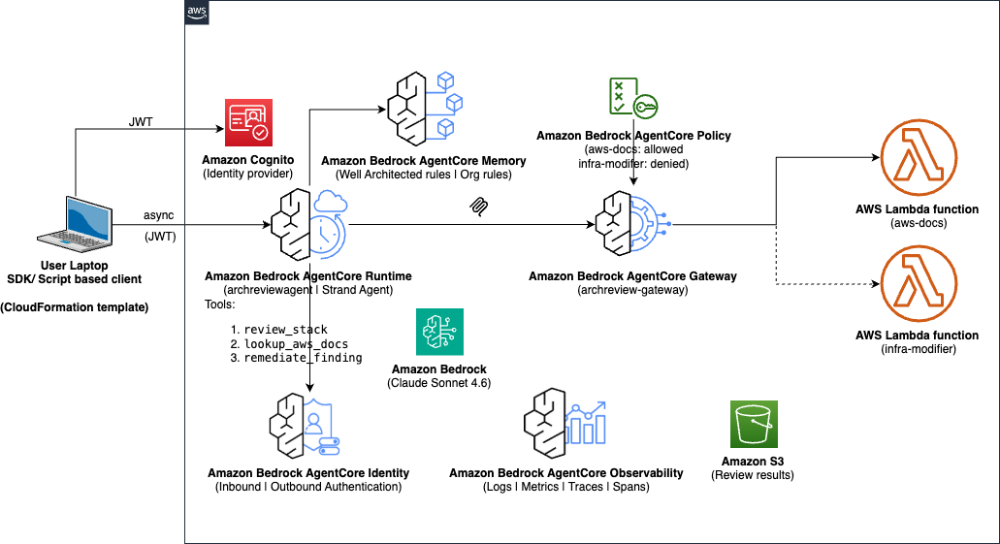

# Sample architecture review agent

An AI-powered sample agent deployed on Amazon Bedrock AgentCore Runtime that reviews CloudFormation templates against AWS Well-Architected best practices and organization-specific rules. The agent enriches findings with authoritative AWS documentation via AgentCore Gateway and MCP tools. Invoked asynchronously from a CLI client on the developer's laptop.

Note: This is a sample agent to showcase agentic architecture review capabilities. Use your own knowledge base to meet your review requirements. 

## What It Does

The agent combines three analysis approaches:

- **Static analysis:** 89 built-in well architected rules and 10 organization-specific rules check resource properties deterministically (encryption, public access, backups, logging, etc.)
- **Semantic analysis:** Claude Sonnet 4.6 examines resource relationships to detect design-level anti-patterns (async pipelines without error recovery, payment paths with silent failures, etc.) and evaluates organization-specific rules
- **Documentation enrichment:** Critical and warning findings are enriched with links to authoritative AWS documentation via an MCP tool served through AgentCore Gateway

It provides three agent tools:

| Capability | Description |
| --- | --- |
| `review_stack` | Analyze a CloudFormation template and return findings with fixes and doc links |
| `lookup_aws_docs` | Search AWS documentation for best-practice guidance via AgentCore Gateway (allowed by policy) |
| `remediate_finding` | Attempt to auto-fix a finding by modifying live infrastructure - **denied** by an enforced AgentCore policy, demonstrating platform-level governance |

## Architecture

The following is the architecture diagram of the solution:



User invokes **Well Architected Agent** running on **Amazon Bedrock AgentCore Runtime** from CLI of their laptop using `review.py` or `review_async.py`. The user can invoke review agent either synchronously or asynchronously.


The inbound and authentication is managed by **Amazon Bedrock AgentCore Identity** with **Amazon Cognito** as identity provider.

The **Well Architect Review Agent** receives the review request and invokes appropriate tools to perform the review. The agent performs the following activities:
   - Parse template into a Resource Graph (nodes + edges + architectural patterns)
   - Run static analysis (89 built-in rules and the 10 organization-specific rules matched by resource type)
   - Run semantic analysis (Claude Sonnet 4.6 detects design-level anti-patterns)
   - Generate code fixes for each finding
   - Compose developer friendly response (deduplicate, sort by severity, assign sequential IDs)
   - Enrich critical/warning findings with AWS documentation links via AgentCore Gateway

The **CLI client** shows the findings with severity icons and fix recommendations.


The agent accesses AWS documentation tools through AgentCore Gateway, with access controlled by Cedar policies:

| Policy | Type | Tool | Effect |
| --- | --- | --- | --- |
| `AllowSearchDocs` | permit | `aws-docs___search_documentation` | ✅ Allowed |
| `AllowReadDocs` | permit | `aws-docs___read_documentation` | ✅ Allowed |
| `DenyInfraModify` | forbid | `infra-modifier___modify_infrastructure` | ❌ Denied |


## Prerequisites

- Python 3.13+ (client deps: `boto3`, `requests` see `requirements.txt`)
- AWS credentials configured with permissions for:
  - `cognito-idp:InitiateAuth` (to fetch a bearer token for the demo user)
  - `cloudformation:DescribeStacks` (for auto-detecting the runtime ARN)
- [AgentCore CLI](https://docs.aws.amazon.com/bedrock/latest/userguide/agentcore-cli.html) (`npm install -g @aws/agentcore`) for deployment only
- Node.js 18+ - required by the AgentCore CLI
- Access to the `us.anthropic.claude-sonnet-4-6` inference profile in Amazon Bedrock (us-east-1)
- **CloudWatch Transaction Search enabled** (one-time per account) required for traces to appear in the GenAI Observability dashboard. Enable with:

  ```bash
  aws xray update-trace-segment-destination --destination CloudWatchLogs --region us-east-1
  ```

  Or via the CloudWatch console: Settings → X-Ray traces → Transaction Search → Enable. It can take ~10 minutes for spans to begin indexing after enablement.

## Deployment

### 1. Setup

```bash
cd sample-architecture-review-agent

# Create virtual environment
python3 -m venv .venv
source .venv/bin/activate

# Install dependencies
pip install -r requirements.txt
```

### 2. Configure Deployment Target

Copy the `archreviewagent/agentcore/aws-targets.json` file and update your account details:

```bash
cp archreviewagent/agentcore/aws-targets.json.example archreviewagent/agentcore/aws-targets.json
```

```json
[
  {
    "name": "default",
    "region": "us-east-1",
    "account": "YOUR_ACCOUNT_ID"
  }
]
```


### 3. Deploy

The `deploy.py` script handles the full two-phase deployment automatically. Amazon Cognito setup,
`agentcore.json` patching, deploy, gateway ARN resolution, redeploy, and restoring the file to its placeholder state so it stays clean for git:

```bash
python deploy.py
```

On first invocation, the agent automatically seeds the 89 Well-Architected rules and the 10 organization-specific rules into AgentCore Memory.

### 4. Verify Deployment

```bash
# Check deployment status (shows runtime, gateway, memory, policy engine ARNs)
python deploy.py --status

# Review the included test template (a full review takes ~90s)
python review.py test-stack.yaml
```


## Usage


### Review a CloudFormation template asynchronously

A deep review of a large estate can run for minutes. AgentCore Runtime executes it **server-side in the agent's microVM**, so the developer can invoke it and disconnect while the agent keeps working. Reconnecting later on the **same runtime session** retrieves the finished result. The job does not depend on the laptop staying open.

```bash

# Invoke the review agent with your CloudFormation template:
python review_async.py start test-stack.yaml      # prints a SESSION KEY, then "close the laptop"
python review_async.py result <session-key>       # reconnect later and fetch the findings
```

For similation of long running review, you can set the `REVIEW_EXTRA_DELAY_SECONDS` runtime env var in `agentcore.json` to value higher than `0`.


### Review a CloudFormation template synchronously

```bash
python review.py test-stack.yaml
```

### Focus on Specific Pillars

```bash
python review.py test-stack.yaml --pillars security,reliability
```

Accepted values: `security`, `reliability`, `performance_efficiency`, `cost_optimization`, `operational_excellence`, `sustainability`

### Provide Workload Context

```bash
python review.py test-stack.yaml --context "payment processing pipeline"
```

### Validate denied policy invocation

The agent has a `remediate_finding` tool that attempts to modify live infrastructure through the AgentCore Gateway. The Cedar policy `DenyInfraModify` blocks it at the Gateway level - the Lambda is never invoked:

```bash
python review.py test-stack.yaml --remediate "Fix OrderProcessorRole wildcard IAM policy"
```

**Expected outcome:** The agent attempts to call `remediate_finding` to modify the IAM role on live
infrastructure. The AgentCore Gateway intercepts the request, evaluates the Cedar `forbid` policy
(`DenyInfraModify`), and rejects it before it ever reaches the underlying Lambda. 

### Observability

Every agent action is observable in **Amazon CloudWatch**, on two levels:

**1. Native GenAI Observability:** Open the native [Bedrock AgentCore observability dashboard](https://console.aws.amazon.com/cloudwatch/home#gen-ai-observability/agent-core?region=us-east-1) to view traces and spans of the well architected review agent invocations. You can check the sessions, traces spans for AgentCore Runtime and Gateway.

**2. Structured per-stage review traces (CloudWatch Log Analytics):** Each `review_stack` call
emits a single structured `REVIEW_TRACE` log line capturing the timing, status, and key attributes
of every pipeline stage (parse → static analysis → semantic analysis → fix generation → compose →
docs enrichment). Query it in CloudWatch Log Analytics:

```
SOURCE logGroups(namePrefix: ["/aws/bedrock-agentcore/runtimes/archreviewagent"])
| fields @timestamp, @message
| filter @message like /REVIEW_TRACE/
| sort @timestamp desc
```

Example payload (the FM call and the Gateway docs round-trip dominate latency):

```json
{"event": "review_trace", "review_status": "success", "total_duration_ms": 20075,
 "stages": [
   {"stage": "parse", "duration_ms": 0.6, "attributes": {"resource_count": 1}},
   {"stage": "static_analysis", "duration_ms": 0.1, "attributes": {"findings_count": 7}},
   {"stage": "semantic_analysis", "duration_ms": 18702, "attributes": {"findings_count": 8}},
   {"stage": "generate_fixes", "duration_ms": 2.8},
   {"stage": "compose_response", "duration_ms": 0.5},
   {"stage": "docs_enrichment", "duration_ms": 1369}]}
```


### Configuration Files

**`agentcore.json`:** Defines the runtime (with OTEL + JWT inbound auth), memory policy engine with Cedar policies.

**`mcp.json`:** Defines the gateway, tool targets, and policy engine attachment.


## Cleanup

Remove all deployed resources with the cleanup script:

```bash
python cleanup.py
```

Options:

```bash
python cleanup.py --force           # Skip confirmation prompt
python cleanup.py --region us-west-2  # Use a different region
```